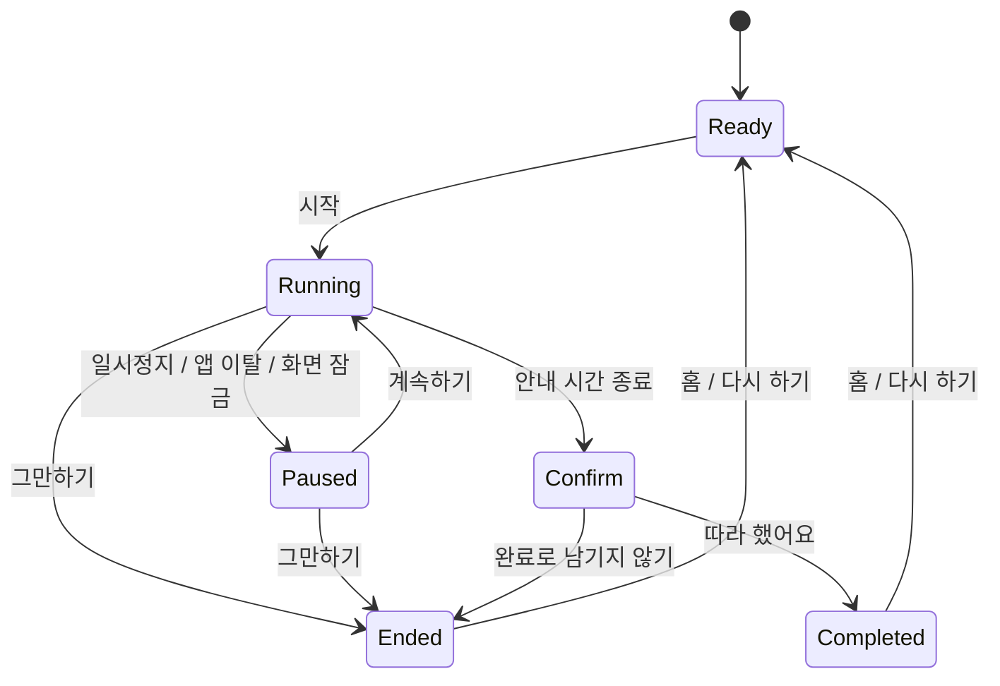

# 짧은 안내 세션 — 화면·상태 흐름 초안

작성일: 2026-11-01. 상태: **30초 기본안 구현·단위/debug UI/전체 R8 release UI 검증 완료**. 60초 옵션은 설계만 유지한다. 제품 가치 검토의 다음 산출물이다. 가격·판매 방식·카메라 도입을 확정하지 않는다. 30초/60초는 체험 길이를 비교하기 위한 UX 값이며 효과가 검증된 운동 처방이나 의학적 기준이 아니다.

## 첫 체험의 목적과 기본안

사용자가 알림을 기다리지 않고 홈에서 바로 짧은 안내를 시작하고 끝낼 수 있게 한다. 기본안은 **30초 화면 휴식 안내**다. 60초는 같은 흐름의 선택 옵션으로 두고 최초 구현은 30초 하나로 제한할 수 있다.

화면 속 마커를 따라 보는 활동은 화면에서 눈을 떼는 휴식과 목적이 다르므로 별도 후보로 둔다. 이번 기본안에 시선 추적·피로도/시력 점수·카메라·오버레이를 결합하지 않는다. 완료는 “안내를 따라 했다고 사용자가 확인한 것”이며 실제 눈 동작을 측정한 증거가 아니다.

## 사용자 흐름

## 화면별 구성·문구

| 화면 | 표시 내용 | 주요 조작·결과 |
| --- | --- | --- |
| 홈 | “잠깐, 화면에서 쉬어갈까요?” / “30초 안내를 따라 휴식해 보세요.” / 오늘 완료 횟수는 기록 기능 구현 후 표시 | **30초 휴식 시작**을 첫 주요 버튼으로 제안. 기존 약 20분 알림은 아래 보조 카드에 유지. 자동 시작/알림 권한 요청 없음 |
| 준비 | “화면을 계속 바라보지 않아도 괜찮아요.” / “안내 시간만 측정하며 눈 동작은 확인하지 않습니다.” | **시작**, **나중에**. 시작 전 카운트다운 없음. 선택한 길이는 시작 후 고정 |
| 진행 | 단계명, 남은 안내 시간, 간단한 문장, **일시정지**, **그만하기** | 단계는 자동 전환. 진행률은 안내 시간만 의미. 화면 추적 목표·성공/실패 판정 없음 |
| 일시정지 | “안내를 잠시 멈췄어요.” / 남은 시간 | **계속하기**, **그만하기**. 재개 전까지 시간 누적 없음 |
| 확인 | “안내 시간이 끝났어요.” / “안내를 따라 휴식하셨나요?” | **따라 했어요 — 완료로 남기기**, **완료로 남기지 않기**. 시간만 지났다고 완료를 기록하지 않음 |
| 완료 | “휴식 안내 1회를 완료로 남겼어요.” / 오늘 완료 횟수(저장 성공 후) | **홈으로**, **다시 하기**. 다시 하기는 준비 화면으로 이동하며 자동 시작하지 않음 |
| 중단 | “안내를 종료했어요. 완료 기록은 남기지 않았습니다.” | **홈으로**, **다시 하기**. 저장된 과거 완료 기록에는 영향 없음 |

30초 안내 단계 초안:

| 단계 | 30초안 | 60초안 | 화면 문구 후보 |
| --- | --- | --- | --- |
| 준비 | 5초 | 5초 | “편안한 자세로 쉬어갈 준비를 해보세요.” |
| 화면에서 쉬기 | 20초 | 50초 | “화면에서 시선을 떼고 편안히 쉬어보세요.” |
| 마무리 | 5초 | 5초 | “준비되면 앱으로 돌아와 마무리해 주세요.” |

기본은 무음이다. 사용자가 화면에서 시선을 떼면 종료를 바로 알아채기 어렵다는 제약이 있다. 첫 초안은 돌아온 뒤 확인 화면을 보는 방식이고, 선택형 종료 소리/진동은 후속 체험 비교 대상으로 둔다. 기기 음량·화면 유지·알림 설정을 임의 변경하지 않는다.

## 상태·시간 처리 기준

- Ready에는 선택 길이만 존재한다. 시작 시 세션 ID와 루틴 버전, 총 안내 길이를 고정한다.
- Running은 화면이 활성 상태인 동안의 경과 시간만 누적한다. 단조 시계 elapsedRealtime 차이로 계산해 프레임 지연/재구성마다 시간이 늘어나는 문제를 피한다.
- 회전/창 크기 변경은 같은 세션·같은 남은 시간을 유지한다. Activity 재생성 자체를 중도 종료나 새 시작으로 세지 않는다.
- 홈 이동·다른 앱 전환·화면 잠금은 일시정지한다. 앱으로 돌아와도 자동 재개하지 않는다. 동시에 여러 창을 쓰는 경우에도 Activity가 비활성화되면 일시정지하는 단순 정책부터 적용한다.
- 프로세스 종료 후에는 미완료 세션을 자동 재개하지 않고 Ready로 돌아간다. 중단 안내를 한 번 표시할 수 있으나 완료 기록은 만들지 않는다. 재부팅 후 이어 하기 없음.
- 진행/일시정지 중 뒤로 가기는 확인창 없이 그만하기와 같은 종료로 처리한다. 30초 세션에서 종료를 막지 않으며 다시 시작할 수 있게 한다.
- Confirm에서 뒤로 가기·홈 이탈 후 앱 종료는 완료로 남기지 않는다. Confirm의 이중 탭/재구성/화면 회전으로 완료가 중복 기록되지 않아야 한다.
- 기록 저장 실패 시 성공 화면/횟수 증가를 표시하지 않고 “완료 기록을 저장하지 못했어요”와 **다시 저장**, **기록 없이 홈으로**를 제공한다.

## 완료 기록 최소안

실측 건강 데이터가 아닌 **사용자가 확인한 안내 완료**만 기록한다.

| 값 | 용도 |
| --- | --- |
| sessionId | 중복 저장 방지 |
| routineId / routineVersion | 어떤 안내를 사용했는지 구분 |
| plannedDurationSeconds | 선택한 안내 길이 |
| completedAtEpochMillis / completedLocalDate | 완료 시각·당시 현지 일자. 날짜 변경 후 과거 기록을 임의로 다른 날짜로 옮기지 않음 |
| confirmation | user_confirmed 고정. 카메라 측정/실제 휴식 시간으로 해석하지 않음 |

진행 중 시간, 중단 이력, 눈 좌표, 능력 점수는 이 최소안의 영구 기록 대상이 아니다. 요약은 “오늘 완료로 남긴 안내 N회”로 표시하고 연속 달성 경쟁·치료 효과·보장 문구를 넣지 않는다.

현재 데이터 저장은 SharedPreferences 중심이다. 최초 구현에서는 기존 PreferencesManager의 과거 점수 키와 분리한 소규모 로컬 저장소를 제안한다. 최근 100회까지만 유지하고 이 제한을 기록 화면에 알린다. 세션 ID 기준 중복 제거와 단일 레코드 목록 저장을 한 곳에서 처리한다. 저장 실패는 UI에 반환하며 회수/완료 횟수를 별도 중복 카운터로 관리하지 않는다. 계정/서버 동기화는 추가하지 않는다.

‘이 기기의 앱 기록 전체 삭제’는 새 완료 기록도 함께 지우고 실행 중 세션을 종료해야 한다. 방침/삭제 확인 문구·백업 제외 범위도 구현과 함께 갱신한다.

## 기존 타이머와의 관계

- 안내 세션을 시작/완료/중단해도 기존 20분 예약을 자동 생성하거나 재설정하지 않는다.
- 기존 타이머가 실행 중이면 홈 보조 카드에 계속 표시한다. 기존 예약 종료 버튼은 그대로 접근 가능하게 한다.
- 세션 중 기존 알림이 오는 경우 세션 상태를 자동 변경하지 않는다. 알림의 기존 본문/종료 액션도 세션 완료 기록을 생성하지 않는다.
- 향후 “휴식 완료 후 다음 알림 시작” 옵션은 자동 반복과 혼동되지 않게 별도로 설계한다. 이번 범위에서 추가하지 않는다.

## Android 구현 범위 제안

현재 실제 UI는 src/production/kotlin이다. 보존된 src/main/java의 같은 이름 UI를 수정하지 않는다.

- SessionState와 시간/단계 전환을 UI와 분리한다. 화면 상태는 ViewModel로 유지하고 기존 Compose/Material 3 구성과 연결하는 안이다.
- 진행 화면은 단순 Column/Card/Text/Button으로 충분하다. 새 내비게이션 라이브러리나 카메라 SDK 도입 없이 홈↔세션 화면 전환부터 구현한다.
- 앱 생명주기 이탈과 구성 변경을 구분하고 화면 활성 구간만 누적한다. UI 재구성마다 새 세션/타이머를 만들지 않는다.
- 기록 접근은 작은 저장소 인터페이스로 제한한다. 지속 기록이 저장되기 전 성공을 표시하지 않는다.
- 접근성: 버튼에 텍스트 이름, 큰 글꼴에서 스크롤 가능, 단계마다만 안내 읽기. 매초 남은 시간을 TalkBack으로 반복 읽지 않는다.

이 항목은 구현 지침이며 이번 작업에서 적용한 코드가 아니다.

## 짧은 검증 계획·수용 기준

초안 작성 후 후속 구현을 진행했다. 최신 실행 결과는 아래 구현 기록과 Walkthrough 최신 항목을 따른다.

| 짧은 검사 | 수용 기준 |
| --- | --- |
| 단위: 가짜 단조 시계로 단계/일시정지 | 5/25/30초 경계, 중단 중 시간 미누적, 중복 완료 방지. 실제 대기 없음 |
| UI: 시작→일시정지→계속→그만하기 | 상태/버튼 정상, 완료 횟수 증가 없음. 60초 이내 |
| UI: 30초 안내 1회→확인→완료 | 사용자 확인 전 기록 0, 확인 후 1회. 60초 내외 |
| UI: 회전·홈 이탈/복귀 | 회전 시 같은 세션, 홈 이탈 시 일시정지·수동 재개. 60초 이내 |
| 저장소: 중복·실패·삭제 | 중복 1회만 저장, 실패 시 성공 표시 없음, 전체 삭제 포함. 실제 대기 없음 |

고정 5분 제한 대신, 오래 걸리는 검증이 필요하면 예상 시간·목적·미실행 시 한계를 먼저 알려 사용자가 진행 여부를 판단하게 한다. 기본은 관련 단위 검사와 짧은 화면 확인이며 장시간 자연 알림·절전 시험은 자동 시작하지 않는다. 20분 알림·절전·재부팅·배터리 장시간 시험은 실행하지 않는다.

## 후속 구현 결과

30초 기본안·최소 완료 기록을 구현했고 단위 18개·debug 실기기 UI 4개·전체 R8 release 외부 UI 1개가 통과했다. 60초는 후속 설계로 남긴다. 저장은 SharedPreferences 대신 IO 스레드의 AtomicFile로 처리한다. [구현·검증 상세](GUIDED_SESSION_IMPLEMENTATION_2026-11-01.md)를 따른다.

## 최초 초안 완료 보고 — 구현 전 기록

- 완료: 화면별 문구/조작, 30초 기본 흐름·60초 옵션, 상태 전이, 중단/회전/이탈 정책, 완료 확인·중복 방지·삭제 기준, 짧은 검증 계획.
- 초안의 이슈: 무음으로 화면을 보지 않으면 종료를 즉시 알기 어렵다. 첫 범위는 복귀 후 확인으로 처리하고 선택형 소리/진동은 후속 검토한다.
- 미완료: 앱 구현·새 UI 기기 검증·사용자 가치 확인. 기존 테스트 통과 결과로 이 세션이 구현됐다고 표시하지 않는다.
- 다음 우선순위: **30초 안내 세션 + 최소 완료 기록을 앱에 구현**, 관련 단위 검사와 5분 이내 짧은 UI 확인.
- 지금 사용자에게 필수인 결정 없음. 30초/무음/카메라 없음은 변경 가능한 초안 기본값이며 최종 제품 결정을 뜻하지 않는다.
